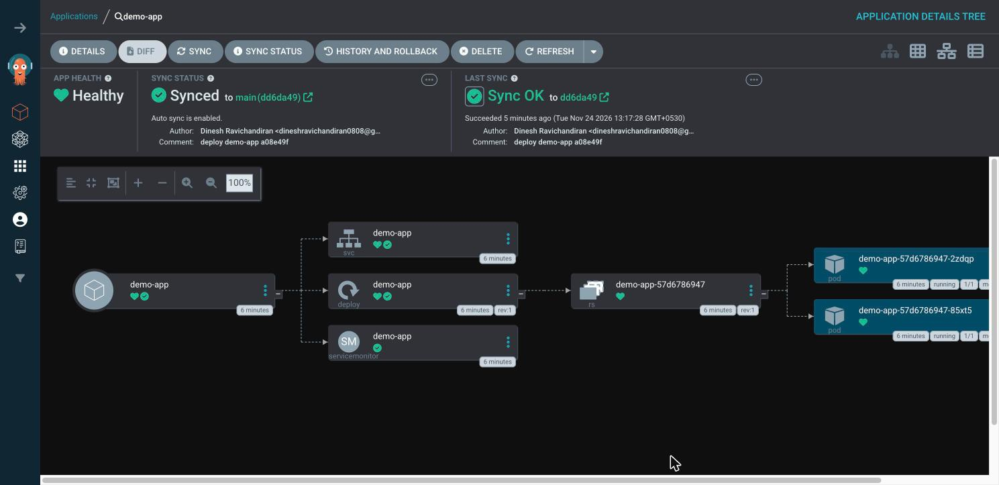
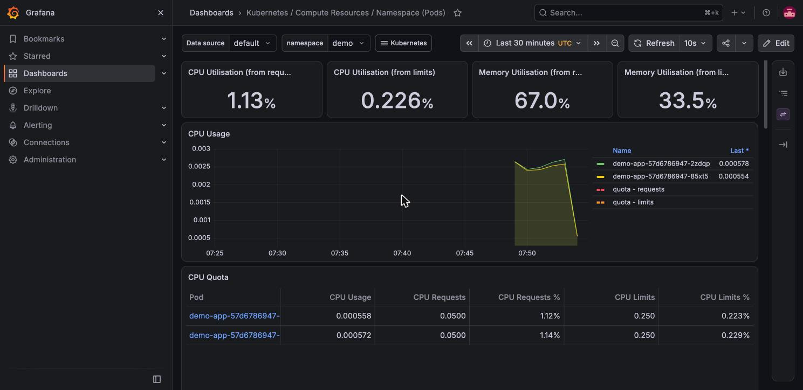

# AKS GitOps platform

A small hands-on lab that builds a Kubernetes platform on Azure from scratch and runs a service on it the way a real team would: infrastructure as code, a CI pipeline, GitOps deployment and monitoring with an alert.

```
 git push (app/)                                   git push (helm/)
      |                                                  |
      v                                                  v
 GitHub Actions  -- build image, push to GHCR -->  values.yaml gets the new tag
  (test, build)                                          |
                                                         v
 Terraform --> AKS cluster  <-- Argo CD watches the repo and syncs the Helm chart
                  |
                  +-- demo-app (Flask, /metrics)
                  +-- Prometheus + Grafana (kube-prometheus-stack)
                  +-- alert rules: error ratio and SLO burn rate
```

## What is in here

| Folder | Purpose |
|---|---|
| `terraform/` | Resource group and AKS cluster (free control-plane tier), state in an Azure Storage account |
| `scripts/` | Creates the state storage, and tears everything down |
| `app/` | Small Flask service with health, work and metrics endpoints, plus tests and a Dockerfile |
| `helm/demo-app/` | Helm chart: Deployment, Service, ServiceMonitor |
| `argocd/` | Argo CD Application that deploys the chart from this repo |
| `monitoring/` | Helm values for Prometheus and Grafana, and the alert and SLO rules |
| `.github/workflows/` | CI: run tests, build and push the image, update the chart's image tag |

## Prerequisites

Azure CLI, Terraform 1.5 or newer, kubectl, Helm, Git, and a GitHub account. An Azure subscription you can create resources in.

## Cost

The AKS control plane is on the free tier. You pay for two small VMs while the cluster exists, so destroy it when you stop for the day. Before starting, set a budget alert in the Azure portal (Cost Management > Budgets). Prices change, so check the current rate for your region.

## Run it

1. Sign in and pick the subscription.

   ```bash
   az login
   az account set --subscription "<your subscription name or id>"
   export ARM_SUBSCRIPTION_ID=$(az account show --query id -o tsv)
   ```

2. Create the Terraform state storage.

   ```bash
   ./scripts/bootstrap-state.sh
   ```

3. Create the cluster.

   ```bash
   cd terraform
   terraform init -backend-config=backend.hcl
   terraform plan -out tfplan
   terraform apply tfplan
   $(terraform output -raw get_credentials_command)
   kubectl get nodes
   ```

   If the apply fails with a quota or size error, set another size, for example `-var vm_size=Standard_D2s_v3`, or another region with `-var location=...`.

4. Push this folder to your own GitHub repository named `aks-gitops-platform`. In the repository settings add two Actions variables, `COMMIT_NAME` and `COMMIT_EMAIL`. The pipeline uses them as the author of its deploy commit. The first push runs the pipeline and publishes the image. After that, open the package on GitHub and set its visibility to public so the cluster can pull it without a pull secret.

5. Install monitoring.

   ```bash
   helm repo add prometheus-community https://prometheus-community.github.io/helm-charts
   helm repo update
   helm install monitoring prometheus-community/kube-prometheus-stack \
     --namespace monitoring --create-namespace \
     -f monitoring/values-kube-prometheus.yaml \
     --set grafana.adminPassword="$GRAFANA_PASSWORD"
   kubectl apply -f monitoring/alert-rules.yaml
   ```

   Set `GRAFANA_PASSWORD` in your shell first. Do not commit it.

6. Install Argo CD and deploy the app.

   ```bash
   kubectl create namespace argocd
   kubectl apply -n argocd --server-side --force-conflicts \
     -f https://raw.githubusercontent.com/argoproj/argo-cd/stable/manifests/install.yaml
   # argocd/application.yaml already points at github.com/dineshravichandiran/aks-gitops-platform
   kubectl apply -f argocd/application.yaml
   kubectl -n argocd get applications
   ```

   Argo CD reads this repository, so it must be public, or you must give Argo CD credentials for it.

7. Look around.

   ```bash
   kubectl -n argocd port-forward svc/argocd-server 8080:443
   kubectl -n argocd get secret argocd-initial-admin-secret -o jsonpath='{.data.password}' | base64 -d
   kubectl -n monitoring port-forward svc/monitoring-grafana 3000:80
   kubectl -n monitoring port-forward svc/monitoring-kube-prometheus-prometheus 9090:9090
   ```

## Demo: break it and watch the alert

1. Send some traffic.

   ```bash
   kubectl -n demo port-forward svc/demo-app 8081:80
   while true; do curl -s localhost:8081/work > /dev/null; sleep 0.2; done
   ```

2. In `helm/demo-app/values.yaml` change `failureRate` to `"0.3"`, commit and push.
3. Argo CD syncs the change. About two minutes later the `DemoAppHighErrorRate` alert shows as firing in Prometheus, and the burn rate climbs in Grafana.
4. Revert the commit and push. Argo CD rolls back, and the alert clears.

Take screenshots of the Argo CD tree, the Grafana dashboard and the firing alert for your notes.

## Screenshots

Captured from the running cluster.

**Argo CD: `demo-app` is Healthy and Synced, deployed from this repository**



**Grafana: CPU and memory of the `demo` namespace**



## Tear down

```bash
./scripts/teardown.sh           # removes the cluster
./scripts/teardown.sh --state   # also removes the state storage
```

## Ideas to extend it

- Add an OpenTelemetry collector and send traces to Tempo or Jaeger.
- Add an Ansible playbook that hardens a VM.
- Add a Lambda function on AWS that restarts a failing service.
- Add a Grafana dashboard for the SLO and keep it in Git.
