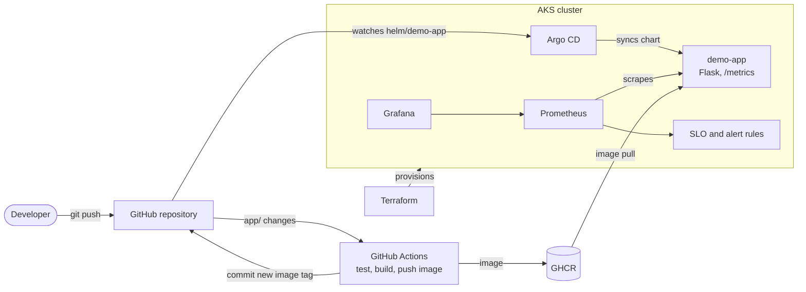
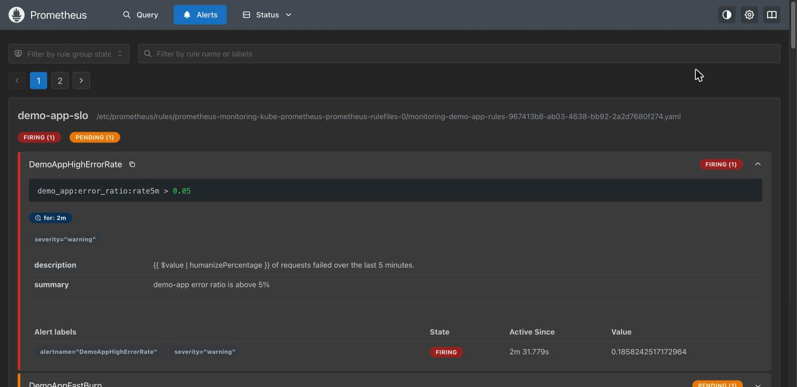

# AKS GitOps Platform

[](https://github.com/dineshravichandiran/aks-gitops-platform/actions/workflows/ci.yaml)


A production-style Kubernetes platform on Azure, built end to end: infrastructure as code, a CI pipeline, GitOps delivery, and observability with SLO-based alerting. A small Flask service runs on it so the whole delivery and monitoring loop can be exercised and broken on purpose.

## Highlights

- **Infrastructure as code.** Terraform provisions the resource group and an AKS cluster (free control-plane tier). State is kept remotely in an Azure Storage account.
- **CI pipeline.** GitHub Actions runs the tests, builds the container image, pushes it to GitHub Container Registry, and updates the Helm values with the new image tag.
- **GitOps delivery.** Argo CD watches this repository and syncs the Helm chart to the cluster, with automated sync, pruning and self-healing.
- **Observability.** Prometheus and Grafana (kube-prometheus-stack) scrape the app through a `ServiceMonitor`.
- **SLO alerting.** A 99% availability SLO, an error-ratio recording rule, a burn-rate rule, and two alerts: `DemoAppHighErrorRate` and `DemoAppFastBurn`.
- **Failure drill.** A single value in Git (`failureRate`) injects errors into the app, so the path from a Git commit to a firing alert can be shown live.

## Architecture



The same flow in text:

```
 git push (app/)                                   git push (helm/)
      |                                                  |
      v                                                  v
 GitHub Actions  -- build image, push to GHCR -->  values.yaml gets the new tag
  (test, build)                                          |
                                                         v
 Terraform --> AKS cluster  <-- Argo CD watches the repo and syncs the Helm chart
                  |
                  +-- demo-app (Flask, /metrics)
                  +-- Prometheus + Grafana (kube-prometheus-stack)
                  +-- alert rules: error ratio and SLO burn rate
```

More detail is in [docs/architecture.md](docs/architecture.md).

## Tech stack

| Area | Tools |
|---|---|
| Cloud | Microsoft Azure, AKS |
| Infrastructure as code | Terraform (azurerm provider, remote state in Azure Storage) |
| CI | GitHub Actions, GitHub Container Registry |
| Packaging and delivery | Docker, Helm, Argo CD |
| Application | Python, Flask, prometheus_client, pytest |
| Monitoring | Prometheus, Grafana, Alertmanager (kube-prometheus-stack) |
| Tracing | OpenTelemetry (Python SDK), OpenTelemetry Collector, Jaeger v2 |
| Configuration management | Ansible |
| Security | Trivy image scanning in CI |
| Local development | Docker Compose |

## Repository layout

| Path | Purpose |
|---|---|
| `terraform/` | Resource group and AKS cluster, with remote state in an Azure Storage account |
| `scripts/` | Creates the state storage, and tears everything down |
| `app/` | Flask service with health, work and metrics endpoints, plus tests and a Dockerfile |
| `helm/demo-app/` | Helm chart: Deployment, Service, ServiceMonitor |
| `argocd/` | Argo CD Application that deploys the chart from this repository |
| `monitoring/` | Helm values for Prometheus and Grafana, and the alert and SLO rules |
| `monitoring/dashboards/` | Grafana SLO dashboard as JSON, and the generated ConfigMap the Grafana sidecar loads |
| `observability/tracing/` | Jaeger and OpenTelemetry collector manifests (optional) |
| `compose.yaml`, `compose/` | Local stack with Docker Compose: app, Prometheus, Grafana, optional Jaeger |
| `ansible/` | Playbook that hardens an Ubuntu/Debian VM |
| `.github/workflows/` | `ci`: test, build, Trivy scan, push, update the image tag. `checks`: dashboard, Ansible, Helm and Compose checks |
| `docs/` | Architecture notes and screenshots |

## Screenshots

**Argo CD: `demo-app` is Healthy and Synced, deployed from this repository**


**Grafana: CPU and memory of the `demo` namespace**


**Prometheus: `DemoAppHighErrorRate` firing during the failure drill (about 19% of requests failing)**



## Getting started

### Prerequisites

Azure CLI, Terraform 1.5 or newer, kubectl, Helm, Git, and a GitHub account. An Azure subscription you can create resources in.

### Cost

The AKS control plane is on the free tier. You pay for two small VMs while the cluster exists, so destroy it when you stop for the day. Before starting, set a budget alert in the Azure portal (Cost Management > Budgets). Prices change, so check the current rate for your region.

### 1. Sign in and pick the subscription

```bash
az login
az account set --subscription "<your subscription name or id>"
export ARM_SUBSCRIPTION_ID=$(az account show --query id -o tsv)
```

### 2. Create the Terraform state storage

```bash
./scripts/bootstrap-state.sh
```

### 3. Create the cluster

```bash
cd terraform
terraform init -backend-config=backend.hcl
terraform plan -out tfplan
terraform apply tfplan
$(terraform output -raw get_credentials_command)
kubectl get nodes
cd ..
```

The default node size is `Standard_B2s_v2`. If the apply fails with a quota or size error, pick a size your subscription allows, for example `-var vm_size=Standard_D2s_v3`, or another region with `-var location=...`.

### 4. Set up the repository and the pipeline

Push this folder to your own GitHub repository named `aks-gitops-platform`. In the repository settings add two Actions variables, `COMMIT_NAME` and `COMMIT_EMAIL`. The pipeline uses them as the author of its deploy commit. The first push runs the pipeline and publishes the image. After that, open the package on GitHub and make sure its visibility is public, so the cluster can pull it without a pull secret.

### 5. Install monitoring

```bash
helm repo add prometheus-community https://prometheus-community.github.io/helm-charts
helm repo update
helm install monitoring prometheus-community/kube-prometheus-stack \
  --namespace monitoring --create-namespace \
  -f monitoring/values-kube-prometheus.yaml \
  --set grafana.adminPassword="$GRAFANA_PASSWORD"
kubectl apply -f monitoring/alert-rules.yaml
```

Set `GRAFANA_PASSWORD` in your shell first. Do not commit it.

### 6. Install Argo CD and deploy the app

```bash
kubectl create namespace argocd
kubectl apply -n argocd --server-side --force-conflicts \
  -f https://raw.githubusercontent.com/argoproj/argo-cd/stable/manifests/install.yaml
kubectl apply -f argocd/application.yaml
kubectl -n argocd get applications
```

Argo CD reads this repository, so it must be public, or you must give Argo CD credentials for it. Edit the `repoURL` in `argocd/application.yaml` if you use a fork.

### 7. Open the dashboards

```bash
kubectl -n argocd port-forward svc/argocd-server 8080:443
kubectl -n argocd get secret argocd-initial-admin-secret -o jsonpath='{.data.password}' | base64 -d
kubectl -n monitoring port-forward svc/monitoring-grafana 3000:80
kubectl -n monitoring port-forward svc/monitoring-kube-prometheus-prometheus 9090:9090
```

Run each port-forward in its own terminal tab. Argo CD is at `https://localhost:8080`, Grafana at `http://localhost:3000` and Prometheus at `http://localhost:9090`.

## Failure drill: break it and watch the alert

1. Send some traffic.

   ```bash
   kubectl -n demo port-forward svc/demo-app 8081:80
   while true; do curl -s localhost:8081/work > /dev/null; sleep 0.2; done
   ```

2. In `helm/demo-app/values.yaml` change `failureRate` to `"0.3"`, commit and push.
3. Argo CD syncs the change and rolls the pods. Restart the port-forward after the rollout, because it is bound to one pod. About three to five minutes after traffic reaches the new pods, the `DemoAppHighErrorRate` alert shows as firing in Prometheus, and the burn rate climbs in Grafana.
4. Revert the commit and push. Argo CD rolls back, and the alert clears.

## SLO and alerts

The service objective is that 99% of requests succeed, which leaves an error budget of 1%.

| Rule | Expression | Fires when |
|---|---|---|
| `demo_app:error_ratio:rate5m` | share of 5xx responses over 5 minutes | recording rule |
| `demo_app:slo_burn_rate:5m` | error ratio divided by the 1% budget | recording rule |
| `DemoAppHighErrorRate` | error ratio above 5% | for 2 minutes, severity warning |
| `DemoAppFastBurn` | burn rate above 14.4 | for 2 minutes, severity critical |

The rules are in [monitoring/alert-rules.yaml](monitoring/alert-rules.yaml).

## Tear down

```bash
./scripts/teardown.sh           # removes the cluster
./scripts/teardown.sh --state   # also removes the state storage
```

Check the Azure portal afterwards for any leftover resource groups.

## Extras

### SLO dashboard as code

`monitoring/dashboards/demo-app-slo.json` is a Grafana dashboard with availability, error budget remaining, burn rate, request rate by status, error ratio, p50/p95/p99 latency and pod restarts. `scripts/build-dashboard-configmap.py` wraps the JSON in a ConfigMap labelled `grafana_dashboard: "1"`, which the Grafana sidecar from kube-prometheus-stack picks up. CI fails if the ConfigMap is out of date.

```bash
kubectl apply -f argocd/observability.yaml   # Argo CD syncs the dashboard (and the tracing stack below)
```

### Tracing with OpenTelemetry and Jaeger

Tracing is off by default. When `tracing.enabled=true` in the Helm values, the app gets `OTEL_EXPORTER_OTLP_ENDPOINT` and sends spans over OTLP/HTTP to a collector, which batches them and forwards to Jaeger. Health checks and `/metrics` are not traced.

```bash
# set tracing.enabled: true in helm/demo-app/values.yaml and push; Argo CD rolls it out
kubectl -n observability port-forward svc/jaeger 16686:16686   # then open http://localhost:16686
```

### Local stack with Docker Compose

```bash
docker compose up --build                    # app :8080, Prometheus :9090, Grafana :3000 (admin / admin)
docker compose --profile tracing up --build  # adds Jaeger on :16686
FAILURE_RATE=0.5 docker compose up --build   # failure drill without a cluster
```

The app, Prometheus and Grafana have healthchecks and start in that order. Grafana comes up with the Prometheus data source and the SLO dashboard already provisioned. The pod panels stay empty locally because they read Kubernetes metrics.

### Ansible VM hardening

`ansible/hardening.yml` configures an Ubuntu/Debian VM: key-only SSH with root login off, UFW default-deny, fail2ban for SSH, automatic security updates, kernel network settings and auditd rules for user and sudo files. It is written to be idempotent.

```bash
cd ansible
cp inventory.example.ini inventory.ini        # add your VM
ansible-playbook hardening.yml --check --diff # dry run first
ansible-playbook hardening.yml
```

### Image scanning

The CI workflow scans the built image with Trivy before pushing it. HIGH and CRITICAL findings are reported, and a fixable CRITICAL finding stops the release. Trivy runs from its container image pinned to a fixed version rather than through a third-party action.

### What has been tested

| Item | Checked how |
|---|---|
| App tracing | Unit tests with an in-memory exporter, plus a real run that sent an OTLP request to a local receiver |
| Dashboard and ConfigMap | JSON validity and ConfigMap generation, checked locally and by the `checks` workflow |
| Ansible playbook | `ansible-lint` (production profile) and `--syntax-check`, run locally and by the `checks` workflow. Not yet run against a real VM |
| Compose file | `docker compose config` validates it. The stack itself has not been started |
| Trivy scan and push in CI | Ran in the `ci` workflow on GitHub (report on HIGH and CRITICAL, block on fixable CRITICAL) and passed |
| Helm tracing values, Jaeger and collector manifests | Written but not yet run on the cluster. The `checks` workflow runs `helm lint` and a render test |

## Author

Dinesh Ravichandiran. GitHub: [dineshravichandiran](https://github.com/dineshravichandiran)

## License

Released under the [MIT License](LICENSE).
